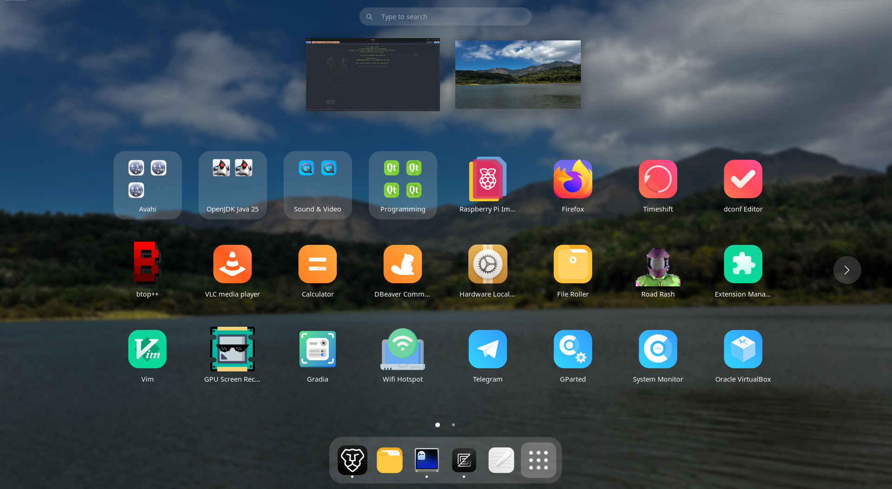

# GNOME App Menu Gradient Sorter (`appmenu-gradient-sort`)

[](https://www.gnu.org/licenses/gpl-3.0)
[](https://www.rust-lang.org)

`appmenu-gradient-sort` is a fast, terminal-based utility and CLI tool written in Rust to automatically organize your GNOME Shell application grid. It can sort your apps into a smooth, continuous rainbow color gradient based on their icon colors, sort them alphabetically, or randomize them—all while safely backing up your layout and folder configurations before any modification.



---

## ✨ Features

- 🌈 **Continuous Rainbow Color Gradient**:
  - **Circular Statistical Color Extraction**: Calculates dominant hues using saturation-weighted circular vector averaging ($\sum s \cos\theta, \sum s \sin\theta$) to prevent angle wrap-around distortion across the $0^\circ / 360^\circ$ red boundary (keeping crimson, coral, and red icons naturally together).
  - **Seamless Spectrum Flow**: Rainbow progression starts at $345^\circ$ (coral/red) and smoothly shifts through Orange → Yellow → Green → Cyan → Blue → Purple → Magenta.
  - **Intelligent Dark & Monochrome Clustering**: Uses perceptual chroma ($\text{chroma} = s \times (1 - |2l - 1|)$) to identify visually dark/black icons (e.g., Terminal, Ghostty, Antigravity, Obsidian, CMake, Zed) and groups them together, ordered by lightness.

- 📁 **Shared-Icon App Folder Creation**:
  - **Ungrouped Analysis**: Begins by breaking up previous arbitrary folder structures to evaluate every installed desktop application individually.
  - **Automatic GNOME Folder Grouping**: Apps that share the exact same icon asset (e.g., OpenJDK Java consoles, Avahi network browsers) are grouped into dedicated GNOME Shell folders (`org.gnome.desktop.app-folders`). This happens for **every** sort mode below, not just the gradient sort.
  - **Smart Folder Naming**: Automatically titles folders using the longest common word prefix (e.g., _"OpenJDK Java 25"_ or _"Avahi"_), falling back to sanitized icon titles.
  - **Configurable Placement**: Folders can be pinned at the very beginning of the grid, or left mixed in with regular apps (sorted/shuffled alongside them, per sort mode) — see "Settings" section below.

- 🔤 **Alphabetical Sort**:
  - Sorts all apps from A to Z based on their localized application names.

- 🔀 **Random Shuffle**:
  - Randomizes all apps across grid pages for a fresh layout.

- 🧹 **Compact Grid**:
  - Packs every page edge-to-edge with zero gaps (not just the first page), preserving each app's current relative order while removing stale/uninstalled entries.

- 💾 **Automatic Backups & Full Reversion**:
  - Automatically creates a timestamped TOML backup (`appmenu-*.appmenu-backup.toml`) before applying any changes.
  - Saves both grid layout positions and GNOME folder configurations, allowing instant, one-click restoration to your exact previous state.

- 🖼️ **Comprehensive Icon Resolution**:
  - Resolves active GNOME icon themes (`gsettings get org.gnome.desktop.interface icon-theme`), user themes (`~/.icons`, `~/.local/share/icons`), system themes (`/usr/share/icons`), and Flatpak/Snap exports.
  - Supports modern `.svg` vector icons via `librsvg` (`rsvg-convert`) with a built-in XML hex fallback, as well as `.png`, `.jpg`, and `.xpm` raster icons.

- ⚙️ **Adjustable Settings**:
  - Icon grouping, group placement, items-per-page, and dash-favorite handling are all toggleable from the TUI and persisted across runs (and honored by the CLI flags too). See "Settings" section.

- 🖥️ **Both Interactive TUI and Scriptable CLI**:
  - Built-in terminal UI (Ratatui & Crossterm) with intuitive keyboard navigation.
  - Scriptable CLI flags for quick execution, dotfile setups, or desktop keybindings.

---

## 🔬 How the Color Sorting Works

Standard HSL hue averaging can cause severe visual bugs when sorting icons. `appmenu-gradient-sort` addresses these using perceptual color science:

```
[Installed Apps] ──> [Icon Theme Resolver] ──> [SVG / PNG Extraction]
                                                        │
┌───────────────────────────────────────────────────────┘
▼
[1. Circular Vector Mean]
   x = Σ s * cos(2π * h)
   y = Σ s * sin(2π * h)
   avg_hue = atan2(y, x)
   (Prevents red icons like Timeshift and Dconf Editor from averaging to blue)

▼
[2. Perceptual Chroma Calculation]
   chroma = saturation * (1 - |2 * lightness - 1|)
   (Distinguishes true chromatic icons from dark slate and neutral icons)

▼
[3. Layout Ordering]
   ├─ [Page 0, 0..N]: Shared-Icon Folders (sorted by gradient)
   ├─ Chromatic Apps: Continuous Rainbow (345° coral/red → 344° magenta)
   └─ Dark & Neutral Apps: Terminal, IDEs, Black/Dark icons (sorted by lightness)
```

1. **Circular Statistics**: Averaging red hues ($15^\circ$ orange-red and $355^\circ$ crimson) as scalar numbers yields $(15 + 355)/2 = 185^\circ$ (cyan/blue). Converting each pixel hue to angular vectors eliminates boundary artifacts.
2. **Shifted Rainbow Origin**: Red spans the $345^\circ \to 15^\circ$ boundary. We shift the sort origin to $345^\circ$ so all red and coral icons sit side-by-side at the beginning of the rainbow rather than split between the ends.
3. **Chroma-Based Dark Clustering**: Icons with dark backgrounds ($L \le 0.28$) often register subtle blue/purple tints in raw RGB. Evaluating effective chroma correctly classifies them as dark neutrals, clustering them neatly by lightness.

---

## 📋 Requirements

- **Linux** running **GNOME Shell 40+** (GNOME 40, 41, 42, 43, 44, 45, 46, 47, etc.)
- `dconf` (pre-installed on almost all GNOME distributions)
- `librsvg` (`rsvg-convert` command) – recommended for vector SVG parsing:
  - **Arch Linux / Manjaro**: `sudo pacman -S librsvg`
  - **Fedora / RHEL**: `sudo dnf install librsvg2-tools`
  - **Ubuntu / Debian**: `sudo apt install librsvg2-bin`
- **Rust & Cargo** (1.70+) to build from source

---

## 🚀 Building & Installation

Clone the repository and build the release binary:

```bash
git clone https://github.com/toocels/gnome_appmenu_sort.git
cd gnome_appmenu_sort
cargo build --release
```

The optimized binary will be produced at `target/release/appmenu-gradient-sort`.

Optionally copy it into your user `PATH`:

```bash
cp target/release/appmenu-gradient-sort ~/.local/bin/
```

---

## 🎮 Usage

### 1. Interactive TUI Mode

Launch without arguments in any terminal:

```bash
appmenu-gradient-sort
```

#### Keyboard Shortcuts

| Key                  | Action                                                      |
| -------------------- | ------------------------------------------------------------ |
| `1` or `s`           | Sort apps by color gradient (rainbow spectrum)              |
| `2` or `r`           | Sort apps randomly                                           |
| `3` or `a`           | Sort apps alphabetically (A to Z)                            |
| `4` or `f`           | Compact grid (fill every page, zero gaps)                   |
| `5` or `b`           | Open the backup restoration list                             |
| `g`                  | Toggle: group apps sharing an icon into folders              |
| `p`                  | Toggle: icon-group placement (beginning vs. mixed in with apps) |
| `-` / `+`            | Decrease / increase items-per-page                           |
| `v`                  | Toggle: skip dash-favorited apps in the grid                  |
| `↑` / `k`, `↓` / `j` | Navigate backups in the restore menu                          |
| `Enter`              | Confirm restore / return to main menu                        |
| `q` or `Esc`         | Quit the application                                          |

> **Tip**: After sorting or restoring, press the <kbd>Super</kbd> key twice (or open and close the Activities overview) to refresh the GNOME Shell app grid.

---

### 2. Command-Line Interface (CLI Mode)

Run operations directly from scripts or keyboard shortcuts:

```bash
# Sort by color gradient (shared-icon folders first, then continuous rainbow)
appmenu-gradient-sort --gradient

# Sort alphabetically (A to Z)
appmenu-gradient-sort --alpha

# Sort randomly
appmenu-gradient-sort --random

# Compact grid: fill every page with zero gaps (no reordering)
appmenu-gradient-sort --fill-first

# Restore layout and folders from a specific backup file
appmenu-gradient-sort --restore path/to/appmenu-2026-09-30_15-15-24.appmenu-backup.toml

# View help and available options
appmenu-gradient-sort --help

# Show version
appmenu-gradient-sort --version
```

> CLI flags honor whichever settings (see below) were last saved from the TUI — or the defaults, if you've never opened it.

---

## 🛠️ Settings

All four preferences below are toggled from the TUI main menu, apply to **every** sort mode (gradient, alphabetical, random, and compact), and persist to `~/.config/appmenu-gradient-sort/config.toml` between runs.

| Key       | Setting                 | Default | Description                                                                                                                                                              |
| --------- | ----------------------- | ------- | -------------------------------------------------------------------------------------------------------------------------------------------------------------------- |
| `g`       | `group_icons`           | ON      | Group apps that share the same icon into a GNOME folder. Off = flatten every folder (yours and ours) back to standalone apps.                                         |
| `p`       | `groups_at_beginning`   | ON      | Pin icon-groups at the very beginning of the grid. Off = leave them mixed in with regular apps, ordered/shuffled per whichever sort mode is running.                  |
| `-` / `+` | `items_per_page`        | 24      | How many icons fit on one app-grid page. GNOME computes this at runtime from your screen/monitor/icon-size and doesn't expose it anywhere readable — count the rows × columns you actually see in the GNOME Overview and set this to match, or every page will have a few blank trailing slots. |
| `v`       | `skip_favorite_apps`    | ON      | Don't place apps pinned to your dash/taskbar in the grid at all. On some GNOME Shell versions a favorited app gets no tile in the app grid even though a slot is still reserved for it there — this avoids wasting that slot on an icon that will render blank. |

> **Why gaps can still appear**: if you still see blank cells after tuning `items_per_page`, check whether the missing app(s) are in your dash (`gsettings get org.gnome.shell favorite-apps`) — `skip_favorite_apps` (on by default) should already route around this, but if you've turned it off, that's almost always the cause.

---

## ⚙️ GNOME Shell Architecture & dconf Keys

This tool interacts directly with GNOME Shell's native configuration schema:

- **Application Grid Layout**:
  ```bash
  dconf read /org/gnome/shell/app-picker-layout
  ```
  Format: A list of dictionaries representing pages (`[{'app.desktop': <{'position': <0>}>, ...}, {...}]`).
- **Application Folders**:
  ```bash
  dconf read /org/gnome/desktop/app-folders/folder-children
  dconf read /org/gnome/desktop/app-folders/folders/<folder-id>/
  ```
- **Dash/Taskbar Favorites** (read-only, used by the `skip_favorite_apps` setting):
  ```bash
  gsettings get org.gnome.shell favorite-apps
  ```

---

## 📦 Backup File Format

Backups are saved as clean TOML files named `appmenu-<YYYY-MM-DD_HH-MM-SS>.appmenu-backup.toml`:

```toml
timestamp = "2026-09-30_15-15-24"
folder_children = ["appmenu-group-network-wired", "appmenu-group-java25-openjdk"]

[[pages]]
# Page 0 (24 items)
[("appmenu-group-network-wired", 0), ("firefox.desktop", 1), ...]

[[pages]]
# Page 1 (24 items)
...
```

Backups can be committed to your dotfiles or restored at any time via the TUI or `--restore`.

---

## 📄 License

This project is licensed under the GNU General Public License v3.0 (GPLv3) - see the [LICENSE](LICENSE) file for details.
